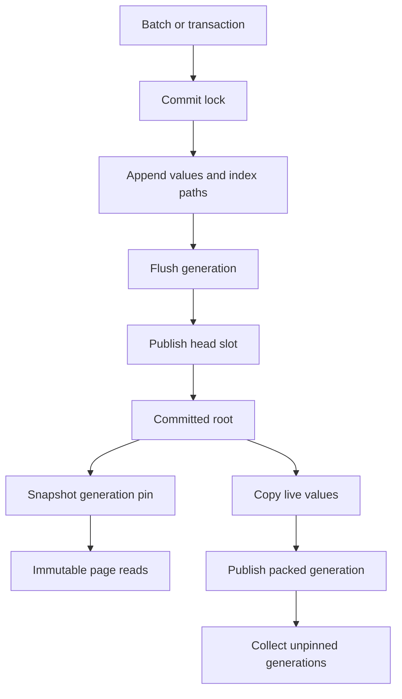
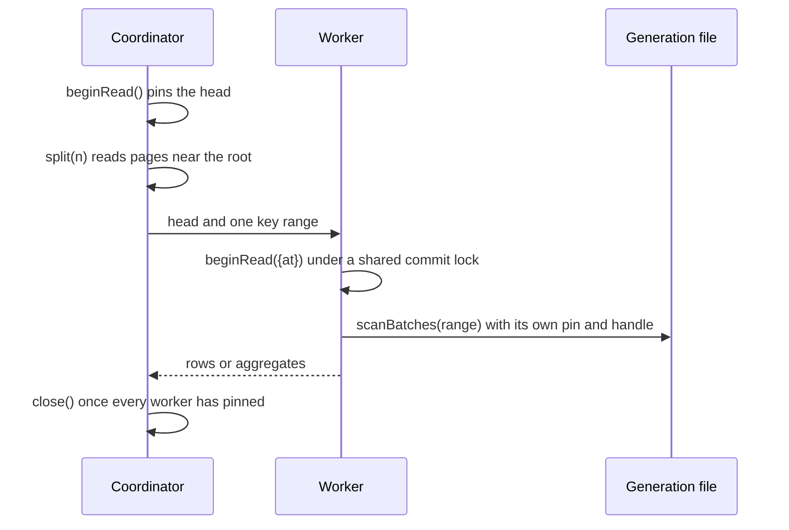

# Architecture

VERIFIED: DBSONL separates a portable transactional engine from byte storage and coordination. DSON owns serialization and frame CRC32C checks. Storage owns bounded writes and portable byte I/O; the native connection adds bounded positional reads of immutable committed data. DBSONL owns immutable indexing, commit ordering, snapshot lifetime and reclamation.

## Why this design

VERIFIED: A persistent B+tree avoids a database-sized RAM map without requiring a second database dependency. Fanout 32 trades modest page sizes for logarithmic tree navigation. Values are separate DSON frames; pages contain only keys, references and revisions. Rewriting a path rather than mutating it gives readers stable roots with no undo log. A batch coalesces edits in private dirty nodes and persists each final dirty page once, avoiding unobservable intermediate roots. An edit whose path is already dirty or cached runs synchronously; only a page read awaits. A bounded cache stores decoded pages, never application values. It evicts by second chance: a hit only marks its page, and eviction moves a marked page to the back once. Exact LRU reordered the Map on every hit, about 5% of a memory commit. Formats 2 and 3 write index pages with `encodePage`, which produces the same frames as `encodeFrame` in trusted mode about 30% faster because it knows the few property names pages use. Format 4 writes compact pages instead: a DSON frame of one byte array with keys sharing the previous key's prefix and varint numbers ([FORMAT.md](docs/FORMAT.md#compact-pages-format-4)). Copy-on-write rewrites every page a commit touches, so page bytes are written once per commit and copied again by every compaction; DSON object pages repeated five property names per entry and stored keys in UTF-16 and numbers as float64. In defuss-db's benchmark store, a 64-document commit rewrote 148 pages, 823 KiB for 13 KiB of documents. Compact pages are a tenth of the size, and a 100,000-document load into that store took 8.7 to 9.5 s instead of 13.0 to 15.7 s under Node 26.13.1, with 5 background compactions instead of 11 and a 33.1 MiB file afterwards instead of 102.2 MiB. A commit edits cached copies of the pages on its paths instead of rereading them, and adds the pages it wrote once their root is published; a page address within a generation never changes meaning, because only an unpublished tail is ever rewritten. Open reads constant-size metadata and generation length, not every value.

VERIFIED: A two-slot manifest avoids relying on atomic rename, which Storage and OPFS do not expose uniformly. Each slot is a checksummed DSON frame in a 4096-byte region. The newest valid publication wins. Writers append after the published end, flush, then replace the older slot. A partial slot is ignored. Formats 3 to 5 end every commit with a commit record in the generation; on native files, whose writes every process sees before a flush, the generation flush alone makes a commit durable and the slot is written without one. A lone durable transaction then took 4.6 ms instead of 8.1 ms under Node, where every flush is a full `F_FULLFSYNC` of about 3.9 ms; the alternative, flushing the head too, doubles that. Recovery after a power loss walks the frames after the head's end and adopts each record that repeats the generation's random seal and chains to the commit before it, as long as every frame up to it passes its checksum ([FORMAT.md](docs/FORMAT.md#commit-records-format-3)). The head is flushed every 16 MiB of generation bytes, which bounds that walk. OPFS and directory handles flush the slot on every commit, because their writes are not known to reach other workers before a flush. An empty head whose generations are all empty is an interrupted create: only `create: true` initializes it, because no slot was published; invalid fields in a checksummed slot, a missing referenced generation or committed truncation fail closed. A failed publication reports `COMMIT_UNCERTAIN`; reread the revision before retrying. Successful publication increments the logical revision once per nonempty batch.

VERIFIED: Format 5, which new databases use, writes index pages only at checkpoints. Between them each commit appends a compact list of its key changes before its record, and the writing handle keeps the changed pages in memory; every other handle replays the records since the last checkpoint onto the written root and keeps the result, so it replays each commit once. A checkpoint comes when the log reaches 16 MiB or the pages held in memory would exceed `maxCachePages`, which bounds both replay and memory. On a 100,000-document defuss-db load with one ordered index this took 2.50 s instead of 3.35 to 3.92 s in commits of 256 and wrote 29 MiB instead of 107 MiB, because a copy-on-write tree otherwise rewrites every page a commit touches. The log stays in the generation: a separate write-ahead file, the plausible alternative, would add a second file to flush, coordinate and truncate, while format 3's records already gave recovery and a durable commit with one flush.

VERIFIED: These choices spend extra write bandwidth on index paths at checkpoints and two small metadata writes during compaction. They remove full replay, since format 5 replays at most the log since its last checkpoint, and read-held writer exclusion. Benchmark evidence separates batch and per-record flush workloads rather than treating them as equivalent. A universal Pareto-optimality claim would require a defined workload distribution and objective function.

## Ownership and lock order

VERIFIED: The commit lock serializes head inspection and publication. A snapshot takes a shared generation pin while holding that lock, then releases the commit lock. While a handle's own commit group holds the lock, that handle pins the group's last flushed head instead: nobody else can publish or collect then, and the group releases the lock only after those pins are granted. Readers therefore never see a head before its flush. Portable reads take short I/O locks in shared mode, and writes and removals take them alone. Storage 0.4 shares read-only handles but rejects `BUSY` when a reader meets an owner or a removal, so the lock turns that rejection into waiting. An exclusive lock for every read, which Storage 0.3 needed, would make parallel scans of one generation take turns, across workers too. Native reads use independent read-only descriptors: committed prefixes are immutable, writers truncate only unpublished tails, and the pin prevents removal. A native snapshot therefore reads concurrently with appends. The lifetime of a read session does not reserve the commit lock.

VERIFIED: Native locks are separate whole-file locks scoped to open descriptions/handles; they do not expire with a clock or heartbeat. A paused process cannot lose ownership to a second writer. The kernel releases ownership on process death. Web Locks release when their worker/context dies. Memory coordination is instance-local. Raw Storage writes and unrelated processes ignoring the protocol are outside the ownership contract.

VERIFIED: Acquisition order is commit lock, generation pin, I/O lock. Snapshot readers use their pin and, for portable adapters, short I/O locks without reacquiring the commit lock. A direct `get()` holds the commit lock until its bounded lookup finishes, which also excludes collection without a separate snapshot pin. Compaction pins both its source and candidate generation before releasing the commit lock. It writes only the candidate and reads the source in short operations. Publication compares the original publication number, so even another compaction causes a conflict. Exclusive compaction keeps the commit lock through the copy for guaranteed progress.

VERIFIED: Commits queued on one handle form a group: the next lock holder checks every member in queue order, appends all of their values and pages with one writer, flushes the generation once and publishes one head. Each member keeps its own revision, so the group equals sequential commits that no reader observed in between. A group is capped by one batch's operation and byte budgets; any failure before publication retries its members one at a time, so one member cannot fail another. The alternative, one publication per commit, paid two flushes per commit in format 2: with four writers on Node under macOS, about 8 ms per commit. Grouping cuts the flushes per commit; the cost is that a member waits for the slowest check in its group.

VERIFIED: A forming group first sets the head that new snapshots pin, then waits while transactions on its handle hold a snapshot but have not queued their commit, waking on every arrival, for at most half the previous group's publication time. Without the wait, four transaction writers on one handle alternated between groups of one and three members, because the writer released first committed again while the other three were still in the next group; on Node under macOS that cost 4.4 ms per commit, and the wait brought it to 2.1 ms in full groups of four. A transaction that outlasts one wait is not waited for again, and a writer with no transaction in flight never waits. An earlier variant waited before setting the pinned head, so snapshots that started during its wait queued behind the lock it held; it measured slower and was dropped.

VERIFIED: A transaction checks the revisions of the keys it read, not the database revision. The commit lock makes the check and publication atomic, so every read is still current at the commit point and the transactions serialize in commit order. Absence is recorded as revision 0, so a key that appears is a conflict. Scans fall back to the database revision, because a range cannot be rechecked without listing what was absent. The whole-database check it replaced rejected disjoint writers: four writers on separate keys retried 1.5 to 2.1 times per commit.

## Parallel scans

VERIFIED: `split(parts)` cuts a snapshot by key, not by byte offset. A generation file holds index pages and the superseded values of overwritten and deleted keys between the live values, so a byte range of it is not a set of rows: a worker scanning bytes would return dead records, and telling them apart needs the index anyway. Key ranges from the index cost a few page reads near the root. Every branch entry stores its subtree's row count, so the cut opens only subtrees above an eighth of one share, then cuts the ordered pieces where the running count reaches each share. A boundary is the first key of the next range, not one code unit past the last key of the previous one, which could exceed the 4096-unit key bound that scan options enforce.

VERIFIED: A parallel scan needs one root in every worker. `beginRead({at})` pins the head of a snapshot that is still open, on any handle of the same files: another worker, thread or process with its own backend. It takes the commit lock in shared mode, so publication and collection stay excluded, but workers that pin at once do not queue: native lock waiters retry every 5 ms, and in three runs each with 8 Node worker threads, the per-run medians of the full scan were 32 to 43 ms with an exclusive lock and 19 to 32 ms with the shared one, over the four I/O and cache settings. Under the lock it checks that the head is not newer than the published one, or that its older generation still exists and holds its end, then takes a shared pin like any snapshot. Until then the original snapshot's pin keeps the generation from collection.

VERIFIED: On native storage, `scanBatches()` runs in worker threads by default once a snapshot range holds at least 5000 rows. `createFileBackend` starts a pool of up to four workers, one fewer than the CPUs, on the first such scan. Each worker opens its own synchronous backend and handle from `dist/scan-worker.mjs`, which ships beside the server build. A scan counts the rows of its range exactly from the index, cuts it into tasks of about 1 MiB of the generation, at least two per worker, and sends each worker the snapshot's head and one task at a time. The workers pin that head with `beginRead({at})`, scan their task with the caller's `batchSize` and `maxBatchBytes`, and send the batches back. The calling thread hands them out in key order, so the rows, their order and the errors match a scan in one thread, and only batches end early at task edges. On 100,000 documents with the defaults this took 105 ms under Node and 113 ms under Bun, against 401 and 418 ms in one thread ([PERFORMANCE.md](docs/PERFORMANCE.md#parallel-scans-on-macos-arm64)).

VERIFIED: Batches are encoded in the calling thread. Encoding them in worker threads was probed on 2026-11-20 and rejected: a value reaches a worker only as a structured clone, and the clone silently turns getters into plain values and class instances into plain objects and drops symbol keys and non-enumerable properties, all of which DSON rejects with an error; it also loses null prototypes and a RegExp's `lastIndex`. Values encoded from the clone would then differ from what `put()` accepts and stores in one thread.

VERIFIED: The gain is smaller than with work that stays in the workers, because the calling thread decodes every structured clone. In a probe on 2026-11-20 with synchronous reads and a cached index, 8 workers that filtered and summed their rows took 18 ms under Node and 20 ms under Bun, and 8 workers that sent every row back took 62 and 39 ms, against 113 and 91 ms in one thread. Filters and aggregates belong in the workers where the query layer can put them, through `split()` and `beginRead({at})`.

VERIFIED: The pool bounds what it holds and what it leaves behind. A worker stops sending a scan's batches while 8 MiB of their frame bytes are unconsumed, so a paused consumer holds the workers back instead of filling memory; with four workers that is at most about 36 MiB of frames plus one batch each. Under a `limit`, only the rows the limit takes are cut into ranges, and the key after the last of them ends the last range. Among 300,000 native rows, a limit of 5000 took 3.3 ms in workers and 2.9 ms in one thread, where cutting the whole interval as finely had taken 26 ms; a limit of 20,000 took 12.6 ms against 26.9 ms. Closing the iterator or the snapshot cancels the scan and returns after every worker has closed its sessions, so their pins end with the snapshot. Between scans the workers are unreferenced, so they never keep a process alive, and they exit after 30 s without a scan. `sizeOf` callbacks cannot cross threads, so such scans, scans below the threshold, `scan()` row iterators, memory and browser backends, and backends created in worker threads, which would oversubscribe the CPUs with nested pools, scan in the calling thread. If the workers cannot start, for example because a bundler did not copy `scan-worker.mjs`, the pool stays off and every scan runs in the calling thread. `scanWorkers: 0` turns it off; `scanWorkers` and `scanThreshold` set the size and the threshold. Four warm workers beat one thread from about 5000 small documents and lost at 2000.

VERIFIED: Each worker has its own page cache. Under the defaults, 1024 pages, one thread scanning 100,000 documents overflows it and decodes the leaf pages again on every scan, while an eighth of the tree fits; the default-cache figures therefore gain more than the worker count. Native backends in worker threads should use `io: 'sync'`. Asynchronous reads go through the libuv thread pool, which every thread of a process shares, while a blocking read stops only the scanning thread. With the defaults, one worker took 227 ms with synchronous and 364 ms with asynchronous reads under Node ([PERFORMANCE.md](docs/PERFORMANCE.md#parallel-scans-on-macos-arm64)).

## Native read and write performance

VERIFIED: Every database handle owns a connection with at most two idle read descriptors and at most eight idle lock descriptors, one per lock name: normally the commit lock, the I/O locks of the head and the current generation, and its pin. Reopening a lock file cost about 60 µs on macOS, three times per transaction. Only an unlocked descriptor is reused, so simultaneous owners still hold distinct open file descriptions and flock keeps them apart. Shared holders on one connection are the exception: the second and later share the first one's flock with a count, and the last release unlocks it. Exclusive requests keep their own descriptor, so they still conflict with that flock while any shared holder remains. Four transactions on one handle pin the same generation; with a descriptor each, three of them opened and later closed a descriptor on the thread pool, missed the next commit group, and four writers alternated between groups of one and three once reads no longer yielded to the event loop. In-flight reads retain their descriptors until completion. Local FIFO admission avoids polling for same-connection commit-lock contention; separate processes still acquire the same kernel lock. Every lock attempt uses the nonblocking call of the shipped N-API binding of pinned `@lickle/lock` 0.0.1. No blocking lock acquisition or timeout-based ownership is introduced.

VERIFIED: `get()` reads the current head under the commit lock on every call. It can overlap this with a lookup through the previously parsed root. That candidate is accepted only if every head byte is unchanged; otherwise it is discarded and the current root is read. Both branches are drained before releasing the lock, including on errors. Native connections read that 8 KiB manifest with a blocking call even when values use asynchronous I/O: every operation reads it, it stays in the page cache, and a blocking read of it took 0.4 to 0.6 µs against 9 to 18 µs for a thread-pool round trip. A cold manifest blocks the event loop for one 8 KiB read. Reads of up to `syncReadBytes`, 16 KiB by default, block the same way: point reads of small values and index pages. In an interleaved probe at a load average near 16, 1000 durable point reads took 17 instead of 46 ms under Node and 23 instead of 48 ms under Bun. A scan's 64 KiB windows stay asynchronous, so a long scan still yields to the event loop between windows. A read the OS page cache cannot serve blocks the thread until the device answers; network or slow storage should set `syncReadBytes: 0`. A per-handle 8 KiB parse cache avoids repeated DSON decoding, not fresh I/O; publication patches in the slot it wrote, so the writer's next read of its own head needs no decode. Aligned comparisons use 32-bit words; measured manual unrolling was not retained because it regressed Node.

VERIFIED: Known-length record references are checked against both committed end and the record budget before allocation. Native reads then fetch and checksum the complete frame. Values are decoded anew for every point lookup. Each native scan or compaction keeps one read-ahead window of at most 64 KiB within its pinned prefix. Large values bypass that window. The writer buffers at most 64 KiB, drains it before the file flush, and only then publishes the head, so buffering never reorders data ahead of publication.

VERIFIED: Native read descriptors do not participate in Storage's exclusive handle registry. This is limited to regular, read-only files and the DBSONL immutability protocol; mutations still use Storage and its I/O lock.

VERIFIED: Mutations keep their Storage handles open between commits. `src/kept-files.ts` wraps the native adapter: a plain open of a head or generation file leases a Storage shared writer that stays open while any handle of that database in the JS realm is open, and the last close releases it. Shared writers read the file size on every call, so other processes' writes stay visible. Each lease is taken inside `withFile`, under the file's I/O lock; a removal, which holds that lock alone, closes the idle files of every adapter in the realm before it unlinks. A new generation closes the idle handles of older ones, and generation names are random and never reused, so a kept descriptor never stands for a newer file of the same name. Opening and closing both files took about 1 ms of a 5.8 ms lone durable transaction in a traced probe at a load average near 15; keeping them open took an interleaved lone transaction from 4.44 to 4.19 ms under Node and from 4.37 to 4.11 ms under Bun ([PERFORMANCE.md](docs/PERFORMANCE.md#compared-with-redis-on-macos-arm64)). A per-handle cache was the simpler alternative, but an idle handle in it would make another handle's removal or open of the same file fail with `BUSY`. Permission changes apply to the next open, as for any open descriptor. Code in the same realm that opens these files through its own Storage adapter, bypassing the backend, gets `BUSY` while a handle of the database is open, not only during a commit. `collect()` unlinks unpinned files and closes its connection's idle reader and idle pin and I/O lock descriptors for each removed generation, so no descriptor of an unlinked lock file is reused. Another idle process may still hold an unlinked descriptor until eviction or database close; OS disk-space release can therefore lag namespace removal. Closing all idle database handles releases those resources. Replacing live head or generation inodes outside this protocol is unsupported.

## Reclamation and crashes

VERIFIED: Compaction copies live values with a streaming bulk builder that retains at most 32 references per level. It copies each value's frame bytes after checking its header and payload checksums, in batches of about 4 MiB read in file order, instead of decoding and re-encoding values in key order: a 100,000-document defuss-db store with one ordered index compacted in 0.25 to 0.34 s instead of 2.9 to 3.6 s, because in key order nearly every value missed the 64 KiB read window. Decoding each value, the plausible alternative, would also catch a frame whose checksum matches but whose value does not decode; such a frame is copied unchanged and still fails where it is read and in `verify()`. Concurrent reads were measured and dropped: 1, 8 and 32 reads in flight took the same time on a warm file cache. It writes both head slots to the new generation before returning. Collection refreshes the alternate slot to the selected head, then tries exclusive pins on obsolete generations. Busy generations remain. Candidate pins protect a concurrent compactor from collection. Abandoned candidates from killed processes become collectible.

VERIFIED: Native lock files for reclaimed generations are removed while the commit lock excludes new pin creation. The current generation and fixed database locks remain. This prevents an inode replacement race between old and new lock owners. Cleanup requires exclusive ownership; there are no age-based stale-lock guesses.

VERIFIED: Data written after the published end is private. A later writer truncates only that unpublished tail. A committed frame with a bad checksum fails when read; `verify()` walks all reachable values and index pages, validates ordering, counts and revisions. Neither compaction nor open repairs published corruption. Old snapshots delay reclamation intentionally, preserving their data.

## Transactions, memory and lifecycle

VERIFIED: Batch values are encoded, and caller frames copied, before admission returns, preventing caller mutation during queued work. Both per-transaction and aggregate pending-byte budgets are enforced. A transaction callback reads from one snapshot plus a bounded staged overlay. The final database revision must still equal its snapshot revision, including read-only transactions and range scans. This conservative validation provides serializability but can reject transactions touching disjoint keys. Automatic retries are omitted because callbacks may have external effects.

VERIFIED: `batchFrames` and `putFrame` commit a DSON frame the caller already encoded, so a caller that keeps an encoded snapshot of a value does not pay for a second encode. Each frame is copied and the copy decoded once at admission, under the limits every read applies, before it can stage. A public flag that marks frames as trusted was rejected: a damaged or malformed frame would commit and then fail at every later read, as `CORRUPT` or `LIMIT_EXCEEDED`, and compaction, which copies frames after checking only their checksums, would carry one whose checksums match into every new generation. Storing the frame as a byte-array value was rejected too: reads would return bytes instead of the value, and the engine would encode the bytes again. A transfer of the caller's buffer instead of a copy detaches the whole `ArrayBuffer`, and under Node 26 a `Buffer` of 300 bytes sat in a shared pool buffer of 65,600 bytes, so a transfer would take the caller's unrelated bytes with it.

VERIFIED: The check has a cost: a caller that encoded its values and committed the frames took 1.12 to 2.06 times as long as `batch` takes to encode and commit the same values ([PERFORMANCE.md](docs/PERFORMANCE.md#caller-encoded-frames-on-macos-arm64)). `db.frame(value)` removes it for a caller that only needs a snapshot to commit later: the engine encodes the value, keeps the bytes in a module-private `WeakMap` under a frozen handle it returns, and commits a handle it finds there without a copy or a decode; that took 0.99 to 1.11 of `batch`'s time. Only the engine can add a handle, so the check is skipped for bytes its own encoder produced and nothing else, which a public trusted flag could not ensure. The bytes are never exposed, so they cannot change after encoding. The cost: a handle does not cross a structured clone or a second copy of the package, such as its CommonJS build beside the ESM one; there it is refused with `TypeError`, and the caller passes a `Uint8Array` frame instead.

VERIFIED: Closing a snapshot rejects new reads, drains admitted reads and releases its pin. Paused iterators do not prevent closure. Closing a database stops admission, drains operations, closes its snapshots and discards its cache. Cancellation is cooperative during waiting and copying. After publication starts, completion is success or an uncertain commit error rather than an ordinary cancellation.

## Operations, security and privacy

VERIFIED: The trusted storage root is application-owned. Native byte and lock files reject symlink traversal where supported; database names are lowercase identifiers. Bounds and backward-only child references reject malformed addresses and disk cycles. CRC32C detects damage, not forgery; a caller's frame is therefore decoded at admission, so a frame with matching checksums but an invalid payload cannot commit. DSON values may be cyclic and contain binary data. Applications needing encryption or authentication must provide those policies separately.

VERIFIED: There is no network service or background maintenance. Applications schedule `compact()` and `collect()` and close snapshots promptly. Maintenance needs enough disk space for the live copy. No telemetry or application-value logging occurs. Tests use temporary databases and real processes. Source, tests, examples and tooling each document their own responsibilities in ARCH.md.
