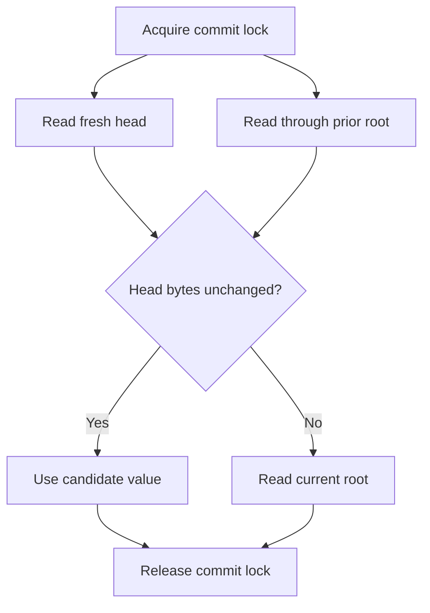

# Performance evidence

VERIFIED: Every table compares builds under the same format, transactional API, durability barriers, values and assertions. The first macOS arm64 tables measure v0.2.0, v0.3.0 and v0.5.0 in the same runs; the 10000-record check measured v0.4.0 in an earlier session. The Linux x64 tables come from an earlier run that measured v0.2.0 and a 0.3.0 build only; no Linux host was available later. The vendored 0.3.0 tarball is the build those Linux tables measured: its `dist` hashes match the recorded artifacts. The Redis section compares the current source with another store instead, under the pairings it states.

## macOS arm64: v0.2, v0.3 and v0.5

VERIFIED: Three consecutive runs of `make bench` under the pinned toolchain (`mise exec`) on an Apple M5 Max (18 logical CPUs), macOS 25.6.0, APFS, Node 24.22.1 (V8) and Bun 1.4.3 (JavaScriptCore), on 2026-11-16. The machine was busy: the 1-minute load average was 8.25 before the first run and 10.96 after the last. Each run takes the median of seven rounds after two warmups; the tables show the median of the three runs. Times are milliseconds per 1000 operations or rows; batch, compaction and reopen are per workload. All three raw reports are in `validation/bench-macos-arm64.json`.

| Runtime | Workload | v0.2 ms | v0.3 ms | v0.5 ms | v0.5 vs v0.3 | v0.5 vs v0.2 |
| --- | --- | ---: | ---: | ---: | ---: | ---: |
| Node | Fresh-root get | 600.01 | 34.92 | 21.28 | 1.64x | 28.19x |
| Node | Pinned snapshot get | 189.58 | 14.40 | 11.72 | 1.23x | 16.18x |
| Node | Snapshot scan | 188.60 | 5.68 | 4.35 | 1.30x | 43.33x |
| Node | Atomic batch | 36.49 | 20.60 | 12.72 | 1.62x | 2.87x |
| Node | Compaction | 237.56 | 29.09 | 19.67 | 1.48x | 12.08x |
| Node | Indexed reopen | 0.75 | 0.55 | 0.62 | 0.88x | 1.21x |
| Bun | Fresh-root get | 515.68 | 44.51 | 44.38 | 1.00x | 11.62x |
| Bun | Pinned snapshot get | 159.85 | 25.10 | 18.51 | 1.36x | 8.63x |
| Bun | Snapshot scan | 168.86 | 10.02 | 6.70 | 1.50x | 25.22x |
| Bun | Atomic batch | 32.24 | 16.22 | 6.67 | 2.43x | 4.83x |
| Bun | Compaction | 183.75 | 20.18 | 10.71 | 1.88x | 17.16x |
| Bun | Indexed reopen | 0.37 | 0.48 | 0.44 | 1.09x | 0.84x |

| Runtime | Mode | v0.2 get ms | v0.3 get ms | v0.5 get ms |
| --- | --- | ---: | ---: | ---: |
| Node | sync | 488.60 | 16.08 | 10.72 |
| Node | memory | 24.00 | 13.63 | 9.77 |
| Bun | sync | 485.93 | 24.24 | 19.14 |
| Bun | memory | 38.07 | 23.14 | 21.06 |

VERIFIED: No v0.5 figure was slower than v0.3 in all three runs. Reopen, a fraction of a millisecond, traded places from run to run, and so did Bun's fresh-root get on native asynchronous I/O and Node's on synchronous I/O. The largest gains are in batches and compaction.

VERIFIED: The 0.4.0 Bun slowdown on reads is gone in these runs. In the 2026-11-15 session, 0.4.0 ran Bun snapshot reads and scans on memory storage 20% to 26% slower than 0.3.0, and scans on native storage 12% to 34% slower. Here v0.5 is faster than v0.3 on each of those workloads: memory snapshot get 4.53 against 7.33 ms, memory scan 3.14 against 6.65 ms, native asynchronous scan 6.70 against 10.02 ms. The three 0.4.0 runs are kept in `validation/bench-macos-arm64-0.4.0.json`. Both sessions ran under different loads, so their milliseconds do not compare directly, and 0.4.0 has no column here.

UNKNOWN: Why Bun ran those 0.4.0 read paths slower; the 0.5.0 runs no longer show it.

VERIFIED: The 10000-record check is one run of `make bench-scale` in the 2026-11-15 session, which measured v0.4.0, native asynchronous I/O, two warmups and three measured rounds, in milliseconds per 10000 lookups. Raw measurements are in `validation/bench-scale-macos-arm64.json`.

| Runtime | v0.2 get ms | v0.3 get ms | v0.4 get ms | v0.4 vs v0.2 |
| --- | ---: | ---: | ---: | ---: |
| Node | 4510.49 | 308.34 | 335.31 | 13.45x |
| Bun | 5377.49 | 465.28 | 357.13 | 15.06x |

## Compared with Redis on macOS arm64

VERIFIED: Three consecutive runs of `mise exec -- make bench-redis` on 2026-11-20, on the host above, with Node 24.22.1, Bun 1.4.3, Redis 8.10.3 from the mise conda build (libc malloc) and the node-redis 5.12.1 client over loopback TCP. They measured the 0.7.0 source with format 3, on defuss-dson 1.5.1 and defuss-storage 0.4.1. Other work kept the machine busy: the 1-minute load average, sampled when each worker started and ended, ranged from 9.9 to 19.7. Each run takes two warmups and seven measured rounds over 1000 records of about 130 JSON bytes, the engine that runs first alternates per round, and each engine's turn starts after a full garbage collection. An atomic batch is one commit of 5000 writes: it rewrites the 1000 records plus 4000 filler records of score 0 that no other workload reads, so both stores hold 5000 records after the first batch. The table shows the median of the three per-run medians, in milliseconds per 1000 operations and, for batches, per batch. The contended figure is the wall time until four writers have committed 1000 transfers together. The raw reports are in `validation/bench-redis-macos-arm64.json`, with three runs of the same day before the changes described below under `before`.

VERIFIED: Durable pairs the native asynchronous file backend with Redis `appendonly yes` and `appendfsync always`. Both engines empty the drive's cache before they answer. defuss-storage 0.4.1 flushes with `fcntl(F_FULLFSYNC)` under Node and Bun, which took 3.2 to 3.9 ms per flush on this host, where a plain `fsync` took 0.02 to 0.07 ms. A lone durable Redis transaction took 3.8 to 4.6 ms, which only a full flush explains. Volatile pairs the memory backend with Redis `appendonly no` and `save ""`. A transfer reads two keys and writes both: Redis sends `WATCH`, two `GET`s and `MULTI`, `SET`, `SET`, `EXEC`; defuss-dbsonl runs `transaction()`. Redis stores JSON strings and defuss-dbsonl encodes DSON. Each contending Redis writer has its own connection, because `WATCH` belongs to a connection; the four defuss-dbsonl writers share one database handle. Both retry on a conflict, and both keep the sum of all scores unchanged in every round.

VERIFIED: The last column repeats the ratio from three runs of 0.5.0 on 2026-11-16, at a load average of 5.5 to 10.9; their reports are in `validation/bench-redis-macos-arm64-0.5.0.json`, and those of 0.4.0 in `validation/bench-redis-macos-arm64-baseline.json`. It reads n/a where the protocol changed since: batches then carried 1000 writes, and durable commits under Bun then flushed with a plain `fsync`. Redis ran at different speeds under the two loads, so only the ratios compare, not the milliseconds. A ratio below 1 means defuss-dbsonl took less time.

| Runtime | Mode | Workload | dbsonl ms | Redis ms | dbsonl / Redis | 0.5.0 ratio |
| --- | --- | --- | ---: | ---: | ---: | ---: |
| Node | durable | Point read | 19.02 | 50.23 | 0.38 | 0.58 |
| Node | durable | Atomic batch | 27.62 | 16.67 | 1.66 | n/a |
| Node | durable | Transaction | 3862.51 | 3867.03 | 1.00 | 1.98 |
| Node | durable | Contended transaction | 980.14 | 3042.93 | 0.32 | 0.65 |
| Node | volatile | Point read | 14.44 | 46.59 | 0.31 | 0.28 |
| Node | volatile | Atomic batch | 20.69 | 10.12 | 2.04 | n/a |
| Node | volatile | Transaction | 101.79 | 173.57 | 0.59 | 0.53 |
| Node | volatile | Contended transaction | 72.21 | 85.91 | 0.84 | 0.83 |
| Bun | durable | Point read | 11.94 | 46.34 | 0.26 | 0.83 |
| Bun | durable | Atomic batch | 19.29 | 12.33 | 1.56 | n/a |
| Bun | durable | Transaction | 3965.32 | 3898.93 | 1.02 | n/a |
| Bun | durable | Contended transaction | 1016.09 | 3244.96 | 0.31 | n/a |
| Bun | volatile | Point read | 18.52 | 41.78 | 0.44 | 0.45 |
| Bun | volatile | Atomic batch | 9.97 | 4.92 | 2.03 | n/a |
| Bun | volatile | Transaction | 92.20 | 170.51 | 0.54 | 0.45 |
| Bun | volatile | Contended transaction | 62.48 | 79.77 | 0.78 | 0.82 |

VERIFIED: defuss-dbsonl took less time than Redis in 11 of the 16 pairings. One of them, the lone durable Node transaction, is a tie: 3.86 against 3.87 ms, inside the spread of the runs, 3.83 to 3.90 against 3.76 to 3.89 ms. Redis took less time for all four batches, by 1.6 to 2.0 times, and for the lone durable Bun transaction, by 2%. No contending writer of either engine retried.

VERIFIED: Three changes since the runs under `before` took the durable figures down; the memory figures stayed within their spread. Durable point reads took 19 instead of 38 µs under Node and 12 instead of 47 µs under Bun, lone durable transactions 3.86 instead of 4.35 ms and 3.97 instead of 4.26 ms, and four contending writers 0.98 instead of 1.23 ms and 1.02 instead of 1.17 ms per commit.

- Reads of up to 16 KiB are blocking calls with the default asynchronous I/O (`syncReadBytes`). A point read of a small value took a thread-pool round trip before. In an interleaved probe, 1000 durable point reads took 17 instead of 46 ms under Node and 23 instead of 48 ms under Bun.
- The head and generation files stay open between commits (`src/kept-files.ts`). In a probe that timed every Storage and lock call of 200 lone Node transactions, opening and closing both files took about 1 ms of 5.84 ms; keeping them open took an interleaved lone transaction from 4.44 to 4.19 ms under Node and from 4.37 to 4.11 ms under Bun.
- Holders of a shared lock on one connection share one flock. With blocking reads, four writers on one handle alternated between commit groups of one and three: the four transactions pin one generation, and three of them opened a lock descriptor of their own and closed it again on the thread pool, so they missed the next group. With one shared flock they form groups of four again, as `tests/commit-groups.test.ts` requires.

VERIFIED: Format 3 changed the durable transactions most, because a commit flushes once instead of twice. A lone Node transaction took 3.86 ms against 7.57 ms on 2026-11-16, and four contending Node writers 0.98 ms per commit against 1.95 ms. Under Bun the same workloads took 3.97 and 1.02 ms, against 0.43 and 0.17 ms with the plain `fsync` of the earlier round; that difference is the cost of the full flush, not of the engine.

VERIFIED: A lone durable transaction cannot get far below Redis's time, because both pay one full flush per commit: in the traced probe above, the generation flush took 3.70 ms per transaction.

VERIFIED: The point reads of the `before` runs, 38 µs under Node against 27 µs on 2026-11-16, lost to the machine's load, not to the engine or the larger database. In one process at a load average of 15 to 17, the 0.5.0 package and the build of those runs read 1000 durable keys in 50 and 46 ms under Node and in 59 and 55 ms under Bun, and adding the 4000 filler records to each batch moved neither build by more than its round-to-round spread.

VERIFIED: In the 2026-11-16 round, collecting garbage before each turn changed the batch figures most. Without it, Redis batches under Bun took about 1 ms in rounds where Redis went first and 3.5 to 8 ms in rounds where it ran right after defuss-dbsonl, and defuss-dbsonl's Node batches took longer in rounds where they went second, because each engine's garbage was collected inside the other's timed work. The round before it, without collection, put Bun's memory batch of 1000 writes at 0.47 of Redis's time; with collection Redis's batch stayed near 1.4 ms and the ratio was 1.61.

VERIFIED: Probes in the same session attributed the gains of the 2026-11-16 round over 0.4.0. defuss-dson 1.4.0 instead of a local plain-data encoder took 5% to 18% off point reads and 23% to 27% off Bun memory batches. Commit groups that wait for in-flight transactions (ARCH.md) took four contending durable Node writers from 4.4 to 2.1 ms per commit; they had alternated between groups of one and three. The index-page writer and the second-chance page cache took four contending memory writers from 59 to 49 µs per commit under Node.

VERIFIED: The batches lose to encoding. In a CPU profile of 5000-write memory batches under Node on 2026-11-20, encoding the values as DSON frames took about 36% of the time, encoding index pages about 15% and editing the tree about 10%. DSON 1.3.0 stores strings as UTF-16 code units, which defuss-dson writes one character at a time in JavaScript; Redis's client serializes with the runtime's built-in `JSON.stringify`. Counting each batch's encoded bytes once instead of three times took the probe's batch from 14.4 to 12.5 to 12.8 ms; the benchmark's batch, timed nine times per run right after a full collection, stayed within its spread. Encoding in worker threads was probed and rejected, because the structured clone that carries a value to a worker changes what DSON accepts ([ARCH.md](../ARCH.md#parallel-scans)).

VERIFIED: Rejected in these probes: splitting pages at 16 or 8 entries instead of 32 left contended memory commits within noise and made memory batches 10% to 30% slower; deduplicating objects by identity in the page writer cost a leaf 1.5 to 2 µs of its gain; inserting cached pages unmarked was slightly slower than marking them. An earlier commit delay that waited before setting the head new snapshots pin measured 3.90 to 3.92 ms per contended Node commit against 3.62 to 3.81 ms without it. Cutting small frames from shared slabs left batch times within run-to-run noise.

## Node 26 against Node 24 on macOS arm64

VERIFIED: On 2026-11-20, on the host above, `scripts/redis-worker.ts` ran the `make bench-redis` workloads with the 0.7.0 build under Node 24.22.1 and Node 26.13.1, both official builds installed by mise. Each mode had one throwaway Redis 8.10.3, and each ran three passes whose first runtime alternated, at a one-minute load average of 3.9 to 7.1. The table gives the median over the passes of Node 26's time divided by Node 24's in the same pass, with the range of the three ratios; below 1 means Node 26 took less time. The reports are in `validation/bench-node-versions-macos-arm64.json`.

| defuss-dbsonl workload | Durable | Volatile |
| --- | ---: | ---: |
| Point read | 0.94 (0.78 to 1.02) | 1.01 (1.01 to 1.12) |
| Batch of 5000 writes | 1.02 (0.90 to 1.08) | 1.01 (0.99 to 1.05) |
| Lone transaction | 0.97 (0.97 to 1.02) | 0.99 (0.98 to 1.12) |
| Four writers | 0.98 (0.96 to 1.02) | 1.01 (0.95 to 1.10) |

VERIFIED: No workload was faster under Node 26 in every pass, and volatile point reads were slower in all three, by 1%, 12% and 1%. The Redis client in the same processes moved between 0.97 and 1.05 of its Node 24 time. The pinned toolchain therefore stays on Node 24.22.1; the test suite also passes under Node 26.13.1.

## Batch scans on macOS arm64

VERIFIED: Three consecutive runs of `mise exec -- make bench-scan` on 2026-11-17, on the host above, with Node 24.22.1, Bun 1.4.3 and defuss-dson 1.5.1, at a load average of 2.2 to 4.7. Each run writes 100,000 documents of four fields (a short string, a number, a two-string array and a Date) in batches of 5000, then scans every one of them per case: the row scan of the vendored 0.5.0 package, the current row scan and the current `scanBatches` with its defaults. One untimed warmup checks that all three return the same count and checksum, then seven rounds alternate their order, each after a full garbage collection. The table shows the median of the three per-run medians in milliseconds per full scan. The raw reports are in `validation/bench-scan-macos-arm64.json`.

| Runtime | Storage | 0.5.0 `scan` | `scan` | `scanBatches` | `scanBatches` vs 0.5.0 |
| --- | --- | ---: | ---: | ---: | ---: |
| Node | memory | 391.4 | 237.2 | 178.8 | 0.46 |
| Node | native async | 341.1 | 316.8 | 247.5 | 0.73 |
| Bun | memory | 345.9 | 219.2 | 179.0 | 0.52 |
| Bun | native async | 322.3 | 306.8 | 269.4 | 0.84 |

VERIFIED: On memory storage the row scan alone took 0.61 of 0.5.0's time under Node and 0.63 under Bun, mostly because scans now read ahead on every backend: 0.5.0 opened, read and closed the memory file once per row. On native storage, which already read ahead, the row scan took 0.93 under Node and 0.95 under Bun, the per-frame saving of defuss-dson 1.5. Batches gain more: one tracked pull per batch, one tree step per leaf, and one `decodeFrames` call per run of frames that the read window holds.

VERIFIED: The same session also measured `scanBatches` on defuss-dson 1.4.0 and on 1.5.0 with the runs switched off, three runs each, medians in milliseconds per full scan:

| Runtime | Storage | defuss-dson 1.4.0 | 1.5.0, no runs | 1.5.1 with `decodeFrames` |
| --- | --- | ---: | ---: | ---: |
| Node | memory | 216.2 | 189.7 | 178.8 |
| Node | native async | 284.1 | 262.4 | 247.5 |
| Bun | memory | 196.2 | 188.6 | 179.0 |
| Bun | native async | 284.1 | 283.7 | 269.4 |

VERIFIED: defuss-dson 1.5.1 converts each frame offset to an int32 before reading. With 1.5.0, run offsets derived from decoded index pages, which are doubles in JavaScriptCore, took Bun off the decoder's int32 code: 503 type-speculation exits in its 32-bit reads, and `scanBatches` took 0.70 of 0.5.0's time on memory storage instead of 0.52, slower than without runs. Node was unaffected. Converting the offsets in defuss-dbsonl gave the same times as 1.5.1 does now, within 2%; the conversion lives in defuss-dson so that every caller gets it.

VERIFIED: Most of what remains is decoding. In a CPU profile under Node on defuss-dson 1.4.0, of one process that loads the 100,000 documents into memory storage and then scans them ten times with `scanBatches`, defuss-dson took 74% of the time: decoding values, checking each frame's checksum, and setting up a reader and limits for every frame. defuss-dbsonl's own code took 14%. defuss-dson 1.5.0 removes most of the per-frame setup; the checksums and building each value remain.

## Parallel scans on macOS arm64

VERIFIED: Three consecutive runs of `mise exec -- make bench-parallel` on 2026-11-20, on an Apple M5 Max with 18 logical CPUs under macOS 25.6.0, with Node 24.22.1 and Bun 1.4.3, at a load average of 13 to 20 from other work. Each run writes 100,000 documents of four fields, as `make bench-scan` does, to the native file backend in batches of 5000. One thread runs `scanBatches` on a handle with `scanWorkers: 0`. Default pool runs `scanBatches` on a default backend, whose own pool of 4 workers scans and sends every row back to the calling thread. N workers is a warm pool of worker threads with a handle each that keep their rows: a round pins a snapshot, splits it into N ranges, sends each worker the head and one range, and ends when every worker has scanned its range and closed its pin. One untimed warmup checks that every case returns the same count and checksum, then seven rounds alternate the order of the cases, each after a full garbage collection on the main thread. Every handle uses the same I/O mode and cache: the default 1024 pages, or 16384 pages and 256 MiB, which hold the whole index. The table shows the median of the three per-run medians in milliseconds per full scan. The raw reports are in `validation/bench-parallel-macos-arm64.json`.

| Runtime | I/O | Cache | One thread | Default pool | 1 worker | 2 workers | 4 workers | 8 workers |
| --- | --- | --- | ---: | ---: | ---: | ---: | ---: | ---: |
| Node | async | default | 401 | 105 | 364 | 215 | 145 | 26 |
| Node | async | whole index | 130 | 79 | 116 | 66 | 34 | 22 |
| Node | sync | default | 238 | 108 | 227 | 132 | 80 | 20 |
| Node | sync | whole index | 121 | 79 | 108 | 59 | 31 | 22 |
| Bun | async | default | 418 | 113 | 417 | 231 | 122 | 31 |
| Bun | async | whole index | 116 | 82 | 122 | 62 | 35 | 32 |
| Bun | sync | default | 265 | 118 | 260 | 143 | 73 | 27 |
| Bun | sync | whole index | 111 | 80 | 104 | 60 | 32 | 28 |

VERIFIED: With the defaults, the default pool scanned 3.8 times faster than one thread under Node and 3.7 times under Bun. Part of that is the page cache: one thread decodes every leaf page again on each scan, while each worker's share of the index fits in its own cache. With the whole index cached, the pool gained 1.6 times under Node and 1.4 times under Bun, because the calling thread decodes every row's structured clone. Workers that keep their rows show decoding alone spread over threads: Node scanned 2.1, 3.9 and 5.5 times faster with 2, 4 and 8 synchronous workers, Bun 1.9, 3.5 and 4.0 times. Synchronous reads helped most where pages miss the cache, because asynchronous reads queue on the one libuv thread pool of the process. The machine was busy, so the 8-worker figures carry the most noise.

VERIFIED: The 5000-row threshold comes from a probe on 2026-11-20 on the same host and data shape: full scans of databases of 2000 to 100,000 documents, nine alternating rounds each, default backend options, a warm pool of 4 workers against one thread, medians in milliseconds.

| Runtime | Rows | One thread | Pool |
| --- | ---: | ---: | ---: |
| Node | 2000 | 4.9 | 5.3 |
| Node | 5000 | 6.3 | 5.3 |
| Node | 10,000 | 13.1 | 9.8 |
| Node | 20,000 | 70.3 | 18.1 |
| Node | 100,000 | 330.5 | 93.2 |
| Bun | 2000 | 3.6 | 4.8 |
| Bun | 5000 | 7.4 | 5.3 |
| Bun | 10,000 | 13.6 | 9.2 |
| Bun | 20,000 | 103.0 | 20.1 |
| Bun | 100,000 | 450.5 | 118.7 |

## Linux x64: v0.2 and v0.3

VERIFIED: Times below are medians of seven measured rounds after two complete warmup rounds, in milliseconds per 1000 operations or rows. Batch means one atomic commit of 1000 mutations, including flushes. Reopen is one indexed open, not 1000 opens. Raw samples, measured build SHA-256 hashes, exact runtime versions and host metadata are in `validation/bench.json` in the source ZIP.

| Runtime | Workload | v0.2 ms | v0.3 ms | Speedup |
| --- | --- | ---: | ---: | ---: |
| Node | Fresh-root get | 1047.47 | 65.36 | 16.03x |
| Node | Pinned snapshot get | 314.26 | 35.76 | 8.79x |
| Node | Snapshot scan | 311.30 | 14.94 | 20.83x |
| Node | Atomic batch | 53.18 | 25.18 | 2.11x |
| Node | Compaction | 370.27 | 32.40 | 11.43x |
| Node | Indexed reopen | 0.95 | 0.77 | 1.24x |
| Bun | Fresh-root get | 1119.24 | 87.27 | 12.83x |
| Bun | Pinned snapshot get | 378.80 | 43.04 | 8.80x |
| Bun | Snapshot scan | 358.17 | 21.72 | 16.49x |
| Bun | Atomic batch | 68.30 | 39.16 | 1.74x |
| Bun | Compaction | 405.82 | 45.94 | 8.83x |
| Bun | Indexed reopen | 0.81 | 0.78 | 1.04x |

### Worker/CLI synchronous I/O and memory

VERIFIED: Synchronous I/O is opt-in through the `createFileBackend(root, {io: "sync"})` option. It blocks its calling thread, including during fsync. Use a worker or CLI when choosing this mode. The asynchronous mode above remains the default. Memory results show the portable path separately.

| Runtime | Mode | v0.2 get ms | v0.3 get ms |
| --- | --- | ---: | ---: |
| Node | sync | 872.49 | 23.76 |
| Node | memory | 45.05 | 31.18 |
| Bun | sync | 952.36 | 45.99 |
| Bun | memory | 82.25 | 56.39 |

VERIFIED: Not every microbenchmark necessarily improves. The raw report includes memory snapshots, scans, batches and reopen costs as well as the native gains. Small sub-millisecond reopen differences and memory-path variation are not hidden by averaging them into a single score.

### 10000-record scaling check

VERIFIED: Native asynchronous I/O, two complete warmups and three measured rounds. Times are milliseconds per 10000 lookups. Raw measurements and the remaining workloads are in `validation/bench-scale.json`.

| Runtime | v0.2 get ms | v0.3 get ms | Speedup |
| --- | ---: | ---: | ---: |
| Node | 10170.90 | 609.91 | 16.68x |
| Bun | 10569.36 | 930.02 | 11.36x |

## Why the read path changed

VERIFIED: Source tracing, instrumented real reads and a Node CPU profile located repeated file open/close operations, lock dispatch, metadata decoding and small reads on the original path. The initial native baseline repeated the slowdown: approximately one second for 1000 fresh-root lookups. A syscall trace could not run because ptrace is disabled in this environment; no syscall-count claim is made.



VERIFIED: Every direct get still reads the current manifest under the cross-process commit lock. Its prior-root candidate is accepted only if all head bytes match. A changed head triggers a fresh lookup; even speculative errors from a generation collected by another process are ignored only when the head changed. Both reads drain before lock release. A stale metadata cache therefore cannot return an older committed value.

VERIFIED: Descriptor reuse removes repeated opens and closes. A local FIFO avoids self-contention polling. The pinned native binding exposes a nonblocking commit-lock attempt without a thread-pool dispatch; contended locks still wait asynchronously. Native read callbacks avoid FileHandle promise bookkeeping while explicit in-flight ownership protects descriptor lifetime. Cached index pages return directly; cache misses remain asynchronous. Known, validated record lengths allow one frame read, allocation and checksum/decode path rather than a header read followed by a payload read. This also applies to portable backends.

VERIFIED: The manifest cache stores parsed metadata only. Every get compares newly read bytes; point values are freshly read and decoded, including after warming. Native scans and compaction have one bounded 64 KiB read-ahead window. A changed-head point read may temporarily hold both its discarded candidate and the current decoded value. The writer coalesces small frames into at most 64 KiB before the existing file-flush/head-publication barrier. None of these changes removes a flush, CRC check, transaction conflict check or snapshot pin.

## JIT and loop-unrolling experiment

VERIFIED: `scripts/microbench.ts` checks equal, unequal, empty, short and unaligned inputs, consumes every result, reverses kernel order and records seven rounds after two warmups. The table measures 20000 comparisons of an 8192-byte manifest in milliseconds.

| Runtime | Byte loop | 32-bit word loop | Four-way unrolled words |
| --- | ---: | ---: | ---: |
| Node | 164.88 | 42.51 | 44.69 |
| Bun | 92.55 | 31.58 | 34.38 |

VERIFIED: The shared implementation uses the word loop with a byte fallback for unaligned buffers or lengths. Four-way unrolling did not consistently beat it across both engines and runs. The results support this specific choice, not a claim that all JITs or workloads are optimally compiled.

## Caller-encoded frames on macOS arm64

VERIFIED: One run of `mise exec -- make bench-frames` on 2026-11-24, on the host above, with Node 24.22.1, Bun 1.4.3 and defuss-dson 1.5.1, at a load average of 3.8 to 4.7. Each case commits 10,000 log records in batches of 256 into a new database: small records of a Date, three short strings and two numbers, 254 bytes per frame on average, and large ones whose message has about 1,900 characters, 3870 bytes per frame. Every path starts from the caller's values and ends when its last batch commits. `batch` commits the values. "Round trip" is a caller that keeps an owned snapshot of each value by encoding it and decoding the copy, then commits the copy with `batch`, which encodes it again. `batchFrames` is the same caller committing its `Uint8Array` frames, which DBSONL copies and decodes once to check. `frame()` is the same caller taking its snapshots with `db.frame()` and committing them with `batchFrames`, which neither copies nor decodes them. Two warmup rounds and seven measured rounds alternate the path order, garbage is collected before each run, and the four paths must write generations of the same size. Medians in milliseconds:

| Runtime | Storage | Records | `batch` | Round trip + `batch` | `batchFrames` | `frame()` + `batchFrames` | `frame()` vs `batch` |
| --- | --- | --- | ---: | ---: | ---: | ---: | ---: |
| Node | memory | small | 26.3 | 53.4 | 43.8 | 27.8 | 1.06 |
| Node | memory | large | 92.9 | 251.3 | 165.9 | 92.9 | 1.00 |
| Node | native async | small | 172.1 | 202.4 | 192.8 | 176.4 | 1.02 |
| Node | native async | large | 276.8 | 449.7 | 349.9 | 287.9 | 1.04 |
| Bun | memory | small | 17.0 | 36.7 | 27.2 | 18.8 | 1.11 |
| Bun | memory | large | 57.4 | 154.3 | 118.3 | 59.9 | 1.04 |
| Bun | native async | small | 169.5 | 206.3 | 194.6 | 167.1 | 0.99 |
| Bun | native async | large | 225.6 | 333.5 | 299.5 | 225.1 | 1.00 |

VERIFIED: `Uint8Array` frames took 0.66 to 0.95 of the round trip's time, because they skip its second encode, but 1.12 to 2.06 of `batch`'s, because the caller's encode plus DBSONL's copy and checking decode cost more than DBSONL's single encode. `frame()` handles skip the copy and the decode, and took 0.99 to 1.11 of `batch`'s time: the snapshot costs the one encode that `batch` would run anyway. Two earlier runs on 2026-11-23, at a load average of 6.4 to 17.4 and before `frame()` existed, gave 0.67 to 0.94 of the round trip and 1.00 to 1.86 of `batch` for `Uint8Array` frames.

## Reproduction and scope

```sh
make setup
make verify
make bench        # 1000 records, both runtimes, async/sync/memory, 7 rounds
make bench-scale  # 10000 records, both runtimes, native async, 3 rounds
make bench-frames # 10000 records as values, caller-encoded frames or frame() handles, both runtimes, memory and native async
```

VERIFIED: The checksum-pinned v0.2.0 and v0.3.0 tarballs are bundled under `vendor/`. Each benchmark child imports one built package, uses a new temporary database, checks every returned value and scan count, verifies the database, and closes it. Version order is reversed between runtimes. Reopen follows close; the OS filesystem cache is warm. The benchmark does not silently select a subset of rounds.

VERIFIED: The Linux environment is a shared AMD EPYC host with an overlay filesystem, Node 24.22.1 and Bun 1.4.3. Neither host establishes cold-device latency, sustained mixed-workload p99, Windows performance, or a universal optimum. CPU contention and runtime tiering cause run-to-run variation.

VERIFIED: Native handle caching retains at most two idle read descriptors and one idle commit descriptor per open database handle. GC unlinks obsolete files; another process retaining an idle descriptor can delay physical disk-space release until eviction or close. Explicit snapshots deliberately retain their generations. Applications should close idle handles, and must not replace live file inodes outside the DBSONL protocol.

VERIFIED: Correctness tests use real storage, file permissions, truncated/corrupt images, actual kernel locks, process termination and browser workers. Mixed v0.2.0 and current Node/Bun writers exercise format and lock interoperability. These checks cover process failure; they do not certify power-loss behavior.
